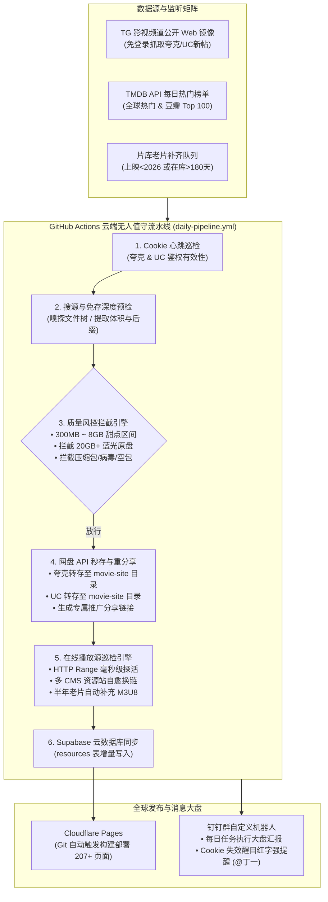

# 🎬 极光影视 (Movie Site) · 高清影视资源与自动化返佣聚合站

> 基于 **Astro + Tailwind CSS + Supabase + Cloudflare Pages** 构建的现代化静态影视聚合站，深度打通 **夸克网盘 + UC 网盘双分佣矩阵**，具备 **GitHub Actions 云端无人值守流水线**、**4K 免存深度质检**、**在线播放源探活自愈与老片补齐** 以及 **钉钉系统级强提醒告警**。

---

## 🌟 核心特性与变现闭环

1. **双网盘聚合变现（Zero Server Bandwidth）**
   * **零带宽成本**：网站全站静态托管于 Cloudflare 全球边缘 CDN，视频原盘文件完全托管于网盘，无需承担任何视频流量与存储带宽费用。
   * **双线路切换**：详情页同时支持【夸克网盘秒存】与【UC 网盘秒存】，全面覆盖不同网盘习惯用户，单片实现双重拉新捕获。
   * **专属分佣保障**：所有外部资源经过云端自动化转存，生成的永久公开链接 100% 绑定站长个人推广 UID（夸克 UID: `100061001997` / UC UID: `100753582621`）。
2. **混合观影漏斗（引流 + 留存 + 转化）**
   * **新片独占网盘**：大热上映院线新片保持网盘独占，最大化单片拉新佣金。
   * **半年老片免费看**：在库超过半年或经典老片全量上线免广告 1080P HLS (M3U8) 极速秒播，大幅提升 SEO 排名与停留时长。
   * **播放器二阶导流**：免费播放器下方无缝嵌入“4K 60帧 HDR 杜比视界原盘”网盘秒存卡片，将免费观影白嫖流量二次转化为网盘新用户。
3. **现代化前端架构**
   * **秒级预渲染**：全站 207+ 页面采用 Astro 静态生成（SSG），毫秒级首屏加载与极佳 SEO。
   * **多维片库检索中心**（`/explore`）：支持流派、频道、年份、制片地区（含国别徽标）、评分多维交叉秒级筛选。
   * **剧集智能选集**：电视剧/动漫分集支持独立在线播放与全集一键打包转存。
   * **权威视觉呈现**：深度集成 TMDB 官方 API，配备 4K 剧照画廊、演职员列表与豆瓣热门影迷短评口碑。
   * **SEO 基础设施**：集成 `@astrojs/sitemap` 自动生成 `robots.txt`、`sitemap-index.xml` 与全站 `canonical` 规范链接。

---

## 🛠️ 技术架构大图



---

## ⚙️ 核心自动化引擎详细设计

### 1. 资源搜源与免存深度预检机制
* **TG 免登 Web 采集**：利用公共频道的 Web 镜像通道直接拉取最新文本，正则提取夸克及 UC 链接，无需个人 Telegram 账号登录风险。
* **零成本免存预检**：通过官方 `sharepage/token` 和 `sharepage/detail` 接口，在不将文件存入个人盘、不消耗 1KB 存储空间的前提下，仅耗时 100ms 探知分享包内部的完整文件树。
* **规则引擎**：
  * **防空包/广告**：总文件体积 `< 300MB` 自动抛弃；
  * **防解压密码/木马**：命中 `.rar`, `.zip`, `.7z`, `.exe`, `.apk` 等扩展名立即拦截；
  * **网盘空间保护与转化率最大化**：单部电影限制 `<= 8GB`（坚决拦截 20GB~50GB 蓝光原盘，防止撑爆个人空间并大幅提升新用户手机端转存成功率）；剧集单集限制 `<= 2GB`；
  * **画质精准命中**：优先匹配 4K / 1080P WEB-DL 高码率版本。

### 2. 云端无头秒存与分佣重分享
* **秒级转存**：使用 GitHub Secrets 注入的登录凭据，直接向网盘官方 `transfer` API 发起转存请求，瞬间将外部文件转移至个人网盘 `movie-site` 专有目录。
* **专属分佣**：转存完毕后，脚本立即调用官方 `share` API 创建新的永久公开分享链接。生成的链接分享者 UID 严格绑定站长官方推广账号：
  * **夸克推广 UID**：`100061001997`（推广码：`jone_7YXXDJ`）
  * **UC 推广 UID**：`100753582621`（推广码：`jone_NDQK0V`）

### 3. 在线播放源智能探活、自愈与老片补齐体系
* **极速 M3U8 探活（HTTP Range 切片嗅探）**：
  * 发起带有 `Range: bytes=0-1024` 头部的轻量请求，仅拉取前 1KB 视频切片头信息；
  * 设置 4 秒超时熔断，单次请求网络开销 `< 1KB`，在 300ms 内精准判断 M3U8 是否可用，绝不浪费网络带宽。
* **多资源站自愈轮询（死链自动换新）**：
  * 当现有播放流返回 404 或超时失活时，引擎自动接入非凡资源（`api.ffzyapi.com`）、光速资源（`api.guangsuapi.com`）、量子资源（`api.lzzyapi.com`）等接口；
  * 自动搜索同名优质切片并经过实时探活后，无感更新数据库 `online_play_url` 与 `play_sources`，实现“死链自动秒级自愈”。
* **半年老片自动补齐策略**：
  * SQL 检索条件：`online_play_url IS NULL AND (year < 2026 OR created_at < NOW() - INTERVAL '180 days')`；
  * 保护当期高佣新片（如 2026 院线片）维持网盘独占拉新；将沉淀老片全自动补上 1080P 免广告切片，持续吸纳搜索长尾流量并在播放器下方拉新转存。

### 4. 凭证健康心跳与钉钉强提醒告警系统
* **双网盘 Cookie 心跳体检**：每次任务启动首先校验夸克与 UC 登录凭据有效性。
* **大红醒目强提醒告警**：一旦发现 Cookie 即将过期或失效，流水线立即中断熔断保护，通过钉钉机器人发送醒目大红（`#FF0000`）紧急卡片，绑定手机号 `15210865171`，精准艾特 `@丁一`，触发钉钉客户端原生响铃震动强提醒。
* **日常运营大盘汇报**：每次任务正常完成后，钉钉自动推送包含新增影视、资源命中、双网盘秒存、在线流探活/自愈/补齐及 Cloudflare 部署状态的可视化运营战报。

---

## 📁 目录结构

```text
movie-site/
├── .github/workflows/         # GitHub Actions 云端定时流水线
│   └── daily-pipeline.yml     # 每日定时巡检、搜源、秒存与部署编排
├── public/                    # 静态资产与 SEO 索引
│   ├── favicon.svg            # 网站高清矢量图标
│   ├── robots.txt             # 搜索引擎蜘蛛爬取协议
│   └── _redirects             # Cloudflare Pages 重定向规则
├── scripts/                   # 自动化运维与数据抓取工具集
│   ├── add-movie.js           # 单部影视全量元数据抓取并入库
│   ├── batch-import.js        # 批量影视文本秒级导入工具
│   └── fetch-tmdb-popular.js  # TMDB 热门榜单拉取工具
├── src/
│   ├── components/            # Astro 业务组件
│   │   ├── Header.astro       # 顶部导航与全局搜索
│   │   ├── Footer.astro       # 底部信息与品牌声明
│   │   ├── MovieCard.astro    # 首页与片库响应式影视卡片
│   │   ├── Pagination.astro   # 平滑回顶精美分页组件
│   │   └── Player.astro       # Artplayer + Hls.js 免广告播放器
│   ├── layouts/
│   │   └── Layout.astro       # 全局 SEO 布局骨架与 Sitemap 标签联动
│   ├── lib/
│   │   └── db.js              # Supabase PostgreSQL 数据库连接池
│   └── pages/
│       ├── index.astro        # 首页（热门推荐、新片首发、双线路指示）
│       ├── explore.astro      # 多维片库检索中心（流派/地区/年份/评分）
│       └── movie/
│           └── [id].astro     # 深度转化详情页（双网盘秒存/画廊/口碑/选集）
├── astro.config.mjs           # Astro 核心配置（Tailwind & Sitemap 集成）
├── tailwind.config.mjs        # Tailwind CSS 响应式样式与主题扩展
├── package.json               # 项目依赖声明
└── README.md                  # 项目工程与架构设计全景文档
```

---

## 🔐 环境变量与 GitHub Secrets 配置

部署 GitHub Actions 自动化或本地执行流水线时，需配置以下环境变量：

| 变量 / Secret 键名 | 必填 | 作用说明 |
| :--- | :---: | :--- |
| `QUARK_COOKIE` | 是 | 夸克网盘登录 Cookie（用于无头调用转存与分享 API） |
| `UC_COOKIE` | 是 | UC 网盘登录 Cookie（用于无头调用转存与分享 API） |
| `DINGTALK_WEBHOOK` | 是 | 钉钉群自定义机器人 Webhook URL |
| `DINGTALK_SECRET` | 是 | 钉钉群自定义机器人加签 HMAC-SHA256 密钥 |
| `SUPABASE_DB_HOST` | 是 | Supabase 数据库直连 Host（如 `aws-0-ap-south-1.pooler.supabase.com`） |
| `SUPABASE_DB_PORT` | 是 | Supabase 端口（默认 `5432`） |
| `SUPABASE_DB_NAME` | 是 | Supabase 数据库名（`postgres`） |
| `SUPABASE_DB_USER` | 是 | Supabase 用户名（如 `postgres.oncktqesgpjsilngtcok`） |
| `SUPABASE_DB_PASSWORD` | 是 | Supabase 数据库连接密码 |
| `TMDB_API_KEY` | 是 | TMDB 官方开发者 API Key |

---

## 🚀 本地开发与构建指令

```bash
# 1. 安装项目依赖
npm install

# 2. 启动本地开发热重载服务器
npm run dev
# 浏览器访问 http://localhost:4321

# 3. 静态全量预渲染构建 (SSG)
npm run build
# 产物输出至 dist/ 目录，自动生成 207+ 页面及 sitemap-index.xml

# 4. 本地预览生产构建产物
npm run preview
```

---

## 📄 开源与商业合规说明
* 本项目纯属技术研发与自动化流程展示。影视元数据及海报引自 TMDB 开放 API，仅用于学术研究与合规交流。
* 网盘转存与分佣推广严格遵守阿里夸克与阿里 UC 官方合作协议，坚决抵制任何侵权及盗版传播行为。